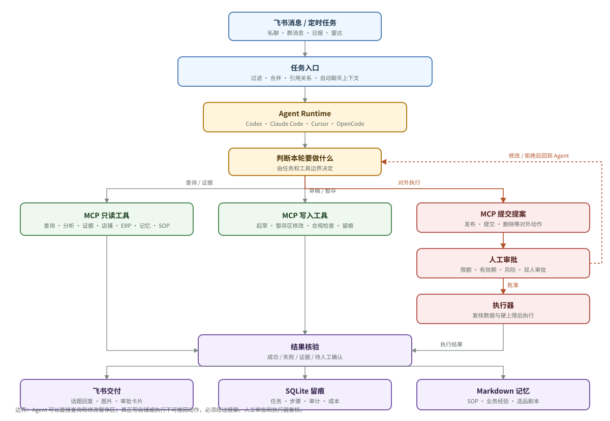

# ecom-twin

通过飞书交办任务，在本机运行的电商运营助手。

ecom-twin 调用 Codex、Claude Code 等 Agent CLI，通过业务工具查询店铺、整理商品草稿、起草客服回复、调研选品，也可以操作内部网页、截图并回复到飞书。任务记录保存在本地，运营规则和经验用 Markdown 维护。

当前版本为 **v0.0.1**，主要围绕飞书、妙手 ERP 和 TikTok 店铺开发。真实上架和仓库流程仍需按店铺、平台逐项验证。

[快速开始](#快速开始) · [接入指南](docs/接入指南.md) · [设计说明](DESIGN.md)

## 可以做什么

| 工作 | 当前支持 |
| --- | --- |
| 商品准备 | 通过妙手采集货源、编辑和认领采集箱商品，检查标题、SKU、定价与合规，提交发布提案 |
| 客服回复 | 按店铺和语言生成草稿，检查禁用说法、金额和承诺，标注风险；人工复制到平台发送 |
| 选品 | 按市场和平台读取选品剧本，调研搜索需求，由代码计算毛利和分数；没有候选商品时先扫描常见品类找方向 |
| 选品雷达 | 按配置的时间检查新词、连续新词、节日备货窗口和痛点词，有信号才生成线索；线索可以转成选品任务 |
| 网页操作 | 截取公开页面，使用专用 Chrome 查看和操作内部平台，将截图发回飞书 |
| 任务跟进 | 自动读取来源会话的近期上下文，引用回复继续原任务；在控制台查看进度和执行记录 |
| 问分身 | 在控制台直接对话，查询任务和线索、创建雷达草稿、触发雷达或继续执行已有任务 |
| 运营规则 | 按任务读取业务记忆和 SOP，提出记忆修改草稿，由人审阅后采纳 |
| 日报 | 导入 ERP 导出表格，计算指标和异常 |

例如，在飞书里发送：

```text
列出已授权的 TikTok 店铺。
检查这批采集箱商品的标题和 SKU，列出发布前需要确认的问题。
截取这个商品页面，把图片回复给我。
tiktok:7300 的买家问：Where is my package? 帮我起草英文回复。
美国站最近有哪些值得做的家居收纳方向？
每天早上帮我看看沙特站加热眼罩有没有新的细分需求。
```

涉及店铺、商品或网页的任务，需要先配置相应账号、权限和数据源。继续处理时，可以引用上一条回复，补充“只改标题，不改价格”。每轮默认读取来源会话近 24 小时、最多 30 条消息，并补充引用和话题内容；不是整个飞书账号的聊天历史。

控制台提供任务看板和列表、选品剧本试算、选品雷达、线索池、问分身、客服草稿、业务记忆、规则与成本记录，支持日间和夜间模式。

## 工作原理



查询、分析和暂存区草稿可以由 Agent 直接处理；真正写店铺或执行不可撤回动作，必须经过提案、人工审批和执行器复核。任务、步骤和审计记录保存在 SQLite，业务规则和经验保存在 Markdown 记忆中。

## 快速开始

需要 Python 3.11+。以下命令适用于 macOS / Linux shell；后台服务管理和桌面操作面向 macOS。

### 先跑演示

```bash
git clone https://github.com/jinronga/ecom-twin.git
cd ecom-twin
git checkout main

python3 -m venv .venv
.venv/bin/python -m pip install -e '.[dev,evidence]'
.venv/bin/ecom-twin demo
```

安装依赖需要联网。安装后，`demo` 使用模拟数据在终端展示提案、审批、执行和看板记录，不需要飞书、妙手或模型账号，也不会发布真实商品。

### 接入飞书

运行配置页面：

```bash
.venv/bin/ecom-twin setup
```

打开命令输出的完整链接，填写飞书应用凭证、负责人 `open_id`、运行时、店铺白名单和审批人。页面会准备缺失的飞书 SDK 和 Agent CLI，账号登录需要单独完成。

在[飞书开放平台](https://open.feishu.cn/app)创建企业自建应用，启用机器人，配置可用范围及消息接收、读取、发送权限。选择“使用长连接接收事件”，订阅 `im.message.receive_v1`，然后发布应用版本。回复图片还需开通 `im:resource:upload` 或 `im:resource` 应用身份权限。负责人 `open_id` 必须来自同一应用。

登录配置页中选择的运行时：

```bash
.venv/bin/ecom-twin login codex
# 使用 Claude Code 时，改为：
# .venv/bin/ecom-twin login claude_code
```

使用妙手功能时，将凭证填入本地 `.env`：

```bash
cp -n .env.example .env
# 编辑 .env，填写 MIAOSHOU_APP_KEY 和 MIAOSHOU_APP_SECRET
```

### 启动任务服务和控制台

保存配置后退出 `setup`。如果已通过配置页启动任务服务，也先将其停止，再运行：

```bash
.venv/bin/ecom-twin check
.venv/bin/ecom-twin serve
# 只使用控制台、问分身、雷达，不连接飞书：
# .venv/bin/ecom-twin serve --local
```

保持终端打开，在飞书私聊机器人发送“请说明你能协助哪些运营任务，以及需要我提供哪些信息”。收到建单回执和 Agent 回复后，再测试业务查询及引用回复。`check` 只检查配置和基础连接，完整任务仍需实际验证。

另开终端，进入项目目录启动控制台：

```bash
.venv/bin/ecom-twin console
```

打开命令输出的完整链接，保留其中的 token。配置页默认端口为 `8765`，控制台为 `8766`，均默认监听本机。负责人链接可修改配置；运营链接可查看任务、审阅记忆草稿、预览客服话术和登记客服草稿发送结果。

确认前台运行正常后，可按[接入指南](docs/接入指南.md#后台运行macos)配置 macOS 后台服务。

## 哪些操作需要确认

采集箱的采集、编辑和认领可以直接写入，系统会校验店铺范围、执行合规检查，并记录修改前后的内容。发布等已实现的提案执行动作需要审批，执行器还会检查限额和有效期。

审批卡片下可回复：

```text
批准 P-0001
拒绝 P-0001 1 成本数据不对
```

将 `P-0001` 换成实际提案号。拒绝原因编号见[接入指南](docs/接入指南.md#审批回复)。

内部网页的提交单据、删除等动作要求 Agent 停在最后一步取得授权。这部分依赖 Agent 遵循指令，浏览器代理无法识别每个按钮的业务后果。自动登录也只适用于负责人配置的完整域名和明确提供的凭证，验证码和 MFA 需要人工处理。

客服功能目前只生成草稿、检查内容和记录人工发送结果，尚未接入平台客服收发接口。风险等级来自关键词规则，发送前仍需核对语境。

选品结果来自搜索下拉词、节日日历和配置的数据源，只能说明需求线索，不能替代平台销量和竞品核对。选品剧本的门槛与权重可以修改，但分数和利润由代码计算；缺少有效汇率或调研快照过期时不会生成评分。

## 配置与文档

| 文档或目录 | 内容 |
| --- | --- |
| [使用教程](docs/使用教程.md) | 从离线演示、飞书接入到任务跟进的图文步骤 |
| [接入指南](docs/接入指南.md) | 飞书上下文、浏览器、客服话术、后台服务及常用命令 |
| [配置示例](config/settings.example.toml) | 运行时、店铺、审批、工具和平台设置 |
| [设计说明](DESIGN.md) | 模块设计与业务流程 |
| [开发记录](PROGRESS.md) | 各阶段实现和验证情况，早期结论可能已被后续记录更新 |
| [memory/](memory/) | Markdown 业务记忆模板 |
| [skills/](skills/) | 项目内的业务 SOP |

从源码运行时，配置和数据默认保存在仓库内：`.env` 放凭证，`config/settings.toml` 放主配置，`config/settings.console.toml` 保存控制台覆盖项，`data/` 放数据库、日志和任务附件。详细位置与覆盖顺序见[接入指南](docs/接入指南.md#配置和数据位置)。

目前提供源码运行和 macOS launchd 服务，尚无 `.app` 或 DMG 安装包。Codex、Claude Code 是主要适配目标；Cursor Agent、OpenCode 已有适配器，仍需真实环境验证。日报依赖 ERP 表格导入，尚未接入各平台的实时数据。第三方选品 API 只提供配置入口，没有绑定具体服务商。

## 开发

`main` 为主分支，`develop` 为开发分支。核心代码在 `src/ecom_twin/`：消息入口和调度负责建单、续跑；`runtime/` 调用 Agent CLI；`mcp_server.py` 提供业务工具；提案、审批和执行分别由对应模块处理。任务和审计记录存入 SQLite，业务记忆存为 Markdown。

```bash
.venv/bin/python -m pytest -q
git diff --check
```

测试覆盖任务路由、上下文、审批、记忆、工具权限、飞书错误处理和截图交付等。部分取证测试需要 Chrome，未安装时会跳过；测试通过不能代替真实平台验收。修改任务行为时，需同时检查新建任务、引用回复和旧会话续跑。

提交前检查差异：`.env`、`config/settings.toml` 和 `data/` 已被 Git 忽略；`config/settings.console.toml` 需自行确保留在本机。`memory/` 中有受跟踪的模板，不要提交实际客户信息。问题反馈附脱敏后的错误码、运行时版本和复现步骤，原始运行记录可能包含任务输入或工具参数，不要直接上传。
