# 电商分身使用教程（边体验边截图）

> 版本：v0.0.1（`origin/main` 5dd5e31）· 体验日期：2026-11-16
> 本文的截图都是在本机实际操作时截的。体验用的是隔离的数据目录（`ECOM_TWIN_HOME`），飞书和妙手没有接真实账号，所以「飞书私聊」「审批卡片」两部分先用文字说明，截图待补。
> 安装和运维的细节见 [接入指南](接入指南.md)，产品介绍见 [README](../README.md)。

## 目录

1. [它是什么](#1-它是什么)
2. [五分钟离线演示](#2-五分钟离线演示)
3. [第一次配置：飞书接入页](#3-第一次配置飞书接入页)
4. [交办第一件事：起草一条客服回复](#4-交办第一件事起草一条客服回复)
5. [记忆库：让它越用越懂你](#5-记忆库让它越用越懂你)
6. [管理页面：规则、底座、成本](#6-管理页面规则底座成本)
7. [接上飞书之后的日常用法](#7-接上飞书之后的日常用法)
8. [常见问题](#8-常见问题)

---

## 1. 它是什么

电商分身是一个**住在飞书里的运营助手**。你在飞书私聊里交代一件事，它在本机调用 Claude Code（或 Codex 等）去查数据、出方案、起草内容，最后把结果或审批卡片发回给你。

它有两条底线：

- **读自动，写审批。** 查东西不用你批；任何会改店铺、花钱、对外生效的操作，都要你批准后才由执行器去做。
- **数字由代码算。** 售价、毛利这些数字由代码计算，模型只负责解释和建议。

你平时会用到三个入口：

| 入口 | 用来做什么 | 怎么打开 |
|---|---|---|
| 飞书私聊 | 交代任务、看汇报、批审批卡片 | 私聊分身机器人 |
| 配置页 | 第一次接入飞书、选 AI 底座、设店铺白名单 | `.venv/bin/ecom-twin setup` |
| 后台控制台 | 看任务、管客服话术和草稿、维护记忆库、改规则 | `.venv/bin/ecom-twin console` |

---

## 2. 五分钟离线演示

不需要任何账号，先跑一遍离线演示，看一次完整的「提案 → 审批 → 执行 → 看板」。

```bash
cd ecom-twin
python3 -m venv .venv
.venv/bin/pip install -e ".[dev]"
.venv/bin/ecom-twin demo
```

演示会模拟「宠物用品 2 款上 TikTok 美区」，实际输出如下（节选）：

```text
== 审批卡片 ==
**提案号**：P-0001　**店铺**：tiktok:10001　**风险**：中
**操作**：miaoshou.tiktok.publish
**理由**：按 US 站规则定价，目标毛利率 30%，两款都是测品款
**依据（代码计算）**
- 合规检查：["商品 901 [提醒] 标题：长度 23 少于建议下限 25", ...]
- 定价明细：
  - 901-Blue：售价 12.99 USD，成本 7.50，毛利 4.45（34.26%）
  - 902-Grey：售价 16.99 USD，成本 10.10，毛利 5.53（32.55%）
**后果**
- 能否撤销：可在 TikTok 后台下架；下架前产生的曝光和订单无法撤回
- 不批准：商品留在妙手采集箱，不上架
回复本消息：「批准 P-0001」或「拒绝 P-0001 原因编号 备注」。

== 审批人回复「批准」 ==
已批准 P-0001，开始执行。
执行回报： P-0001 执行结果：已执行
```

审批卡片里要看的就三样：**每个 SKU 的售价和毛利**、**改了什么**、**后果和能不能撤回**。真接入飞书后，这张卡片会出现在你的私聊里。

> 演示不会发任何真实请求，也不会动你的店铺。

---

## 3. 第一次配置：飞书接入页

```bash
.venv/bin/ecom-twin setup
```

命令会打印一个带令牌的本地链接（只监听 `127.0.0.1`），用浏览器打开。页面左边三步：**飞书接入 → 调度与对话 → 启动任务服务**。

### 3.1 填应用凭证和负责人

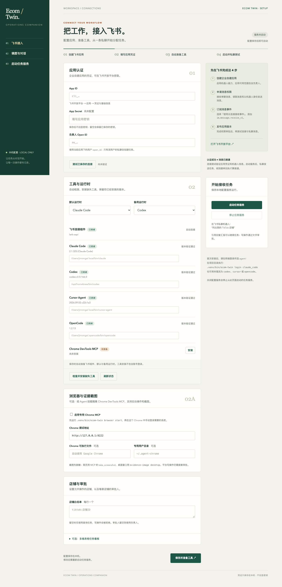

从上往下填：

1. **App ID / App Secret**：飞书开放平台 → 应用 → 凭证与基础信息。Secret 保存后不会再显示，留空表示保留原来的。
2. **负责人 Open ID**（`ou_` 开头）：只有这个人的私聊会建任务，汇报和审批卡片也发给他。**必须是同一个飞书应用下的 open_id。**
3. **工具与运行时**：默认底座选 Claude Code，备用选 Codex。页面会自动检测本机装没装，没装的点「检查并安装缺失工具」。
4. **浏览器与证据截图**（可选）：需要分身操作内部网页、截图取证时才开。

右侧「先在飞书完成这 4 步」是飞书开放平台那边要做的：建企业自建应用并开机器人、申请消息权限、订阅 `im.message.receive_v1`（选「使用长连接」）、发布版本。

### 3.2 设店铺白名单和审批人

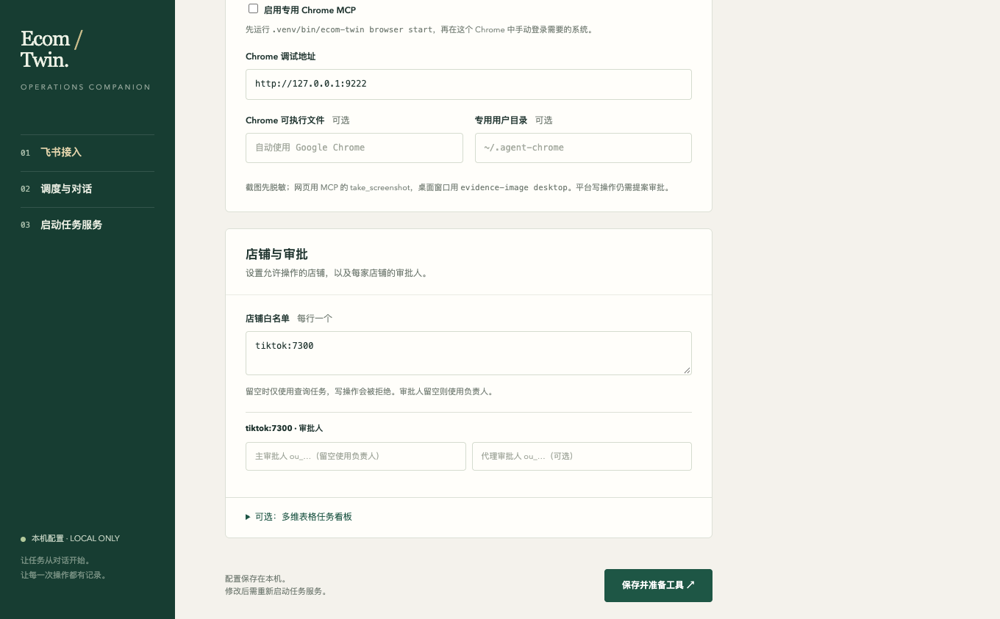

- **店铺白名单**：一行一个，格式 `平台:店铺ID`，例如 `tiktok:7300`。**留空的话所有写操作都会被拒绝**，分身只能做查询。
- 每填一家店，下面会多出一行审批人：主审批人留空就用负责人；代理审批人可选，高风险操作需要两个人都批。

填完点「**保存并准备工具 ↗**」，看到「工具已准备好」就说明存上了。配置写在本机的 `config/settings.toml`，密钥写在 `.env`，两个文件权限都是 `0600`。

### 3.3 启动任务服务，私聊测试

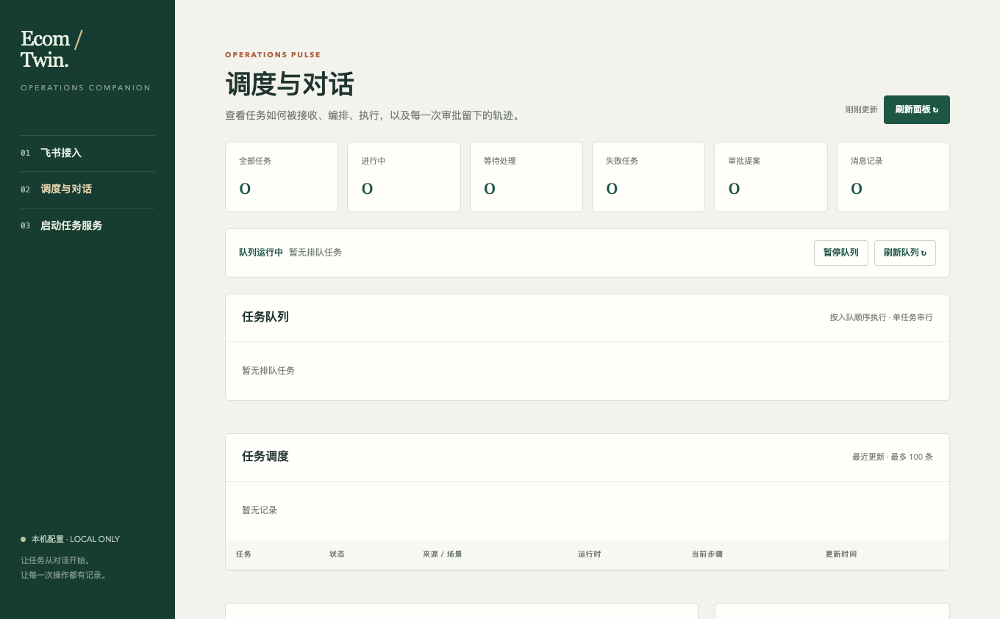

点左边「03 启动任务服务」，然后在飞书私聊机器人发一句「列出我的 TikTok 店铺」。**收到建单回执才算真正接通**，连接测试通过只代表凭证对了。

第一次用某个 AI 底座，还要在终端登录一次：

```bash
.venv/bin/ecom-twin login claude_code   # 或 codex / cursor / opencode
```

「调度与对话」面板能看到任务队列、每个任务当前在哪一步、飞书消息记录和审批提案。

> 想长期在后台跑（开机自启、挂了自动拉起），用 `.venv/bin/ecom-twin start`，见接入指南「常驻服务」。

---

## 4. 交办第一件事：起草一条客服回复

客服回复起草不依赖妙手，是最容易先体验的场景。流程是：**设话术 → 交代任务 → 分身起草并自查 → 你复制到平台发送 → 回来标记结果**。分身不会直接联系买家。

### 4.1 先设一套客服话术

打开后台控制台：

```bash
.venv/bin/ecom-twin console
```

会打印两个链接：**负责人链接**什么都能改，**运营链接**只能看和审阅。用负责人链接，进「客户服务 → 客服话术」，点「+ 新建一套」：

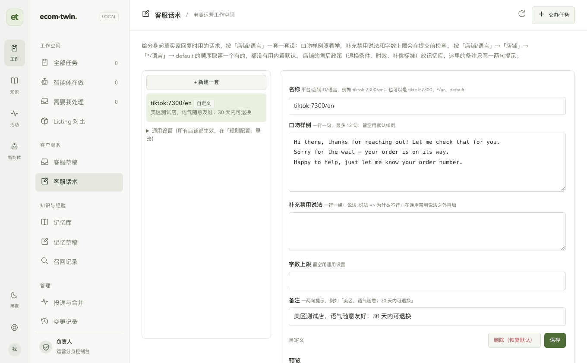

| 字段 | 填什么 | 例子 |
|---|---|---|
| 名称 | `平台:店铺ID/语言` | `tiktok:7300/en` |
| 口吻样例 | 一行一句，分身照着学语气，最多 12 句 | `Hi there, thanks for reaching out! Let me check that for you.` |
| 补充禁用说法 | 一行一组：`说法 => 为什么不行` | 在通用禁用词之外再加 |
| 字数上限 | 留空用通用设置（600） | |
| 备注 | 一两句提示 | `美区测试店，语气随意友好；30 天内可退换` |

话术按「店铺/语言 → 店铺 → */语言 → default」的顺序匹配。**店铺的售后政策（退换条件、时效、补偿标准）放记忆库**，这里的备注只写一句提示。

### 4.2 用「预览」看看哪些话不能说

同一页下面有个「预览」：输入买家消息和一段回复，点「检查」，只算不存。我故意写了一条违规回复：

> So sorry! We will refund you $15 right away, and please leave us a 5-star review.

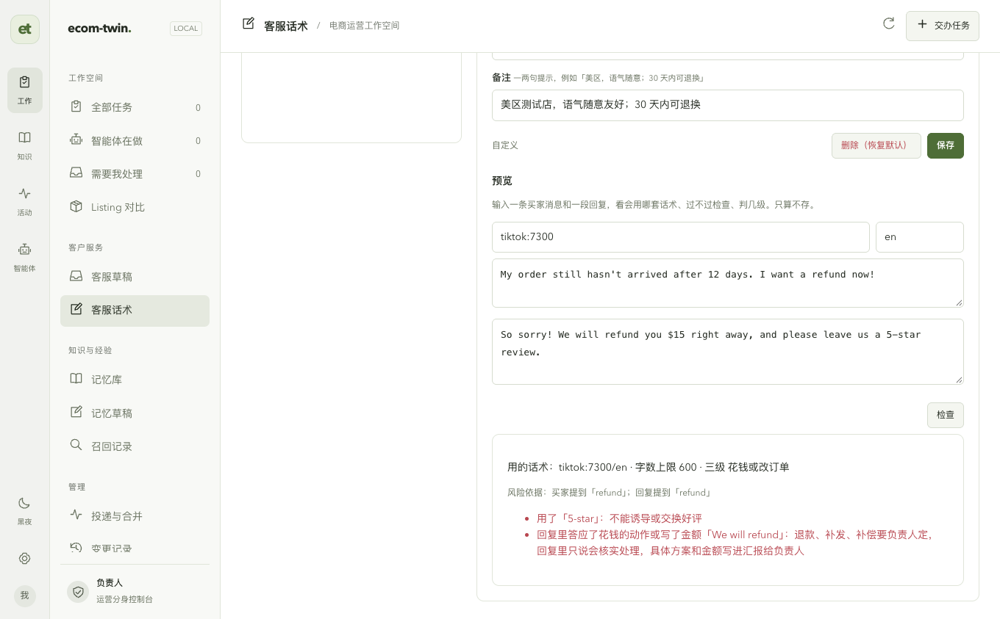

检查拦下了两处：**诱导好评**（5-star）和**在回复里答应退款、写了金额**。同时把这条判为**三级：花钱或改订单**。

客服回复的风险分三级：

| 等级 | 情况 | 分身怎么做 |
|---|---|---|
| 一级 只读答复 | 查物流、尺码、发货时间、解释政策 | 起草，你复制发送 |
| 二级 对外承诺 | 回复里有「几天内」「保证」 | 起草，提醒你确认能兑现再发 |
| 三级 花钱或改订单 | 退款、补发、补偿、取消、改地址 | 回复只说会核实处理，方案和金额写进汇报由你定 |

### 4.3 交代任务

接上飞书后，直接私聊机器人就行。没接飞书时，可以在本机用 `ask --console` 发起，飞书消息只打印在终端：

```bash
.venv/bin/ecom-twin ask "帮我起草一条客服回复。店铺 tiktok:7300，买家用英文写的：「My order still hasn't arrived after 12 days. I want a refund now!」" --console
```

这一单实际用了大约 30 秒，汇报原文如下：

```text
已建任务 T-0001，底座：claude_code
状态：等待回复
等待：等负责人把 CS-0001 复制到 TikTok 后台发出，并定下要不要退款、按什么方式退

回复草稿写好了（CS-0001），检查已通过，风险等级 3（买家要退款）。
草稿里没有答应退款，只向买家要订单号，并告诉对方会去查物流。

**草稿**（复制到 TikTok 后台发送）：
> Hi there, sorry your order hasn't arrived yet — 12 days is too long to wait, and I understand
> the frustration. Could you share your order number here? I'll check the tracking right away
> and get back to you with an update and the options we can offer to sort this out for you.

**中文意思**：抱歉订单还没到，等 12 天确实太久了。麻烦发一下订单号，我马上查物流，再回复您进展和解决办法。

**需要你定的事**：
- 要不要退、怎么退：建议拿到订单号后先查物流……退不退、退多少由你定。
- 店铺的售后规定：记忆库里没有这家店铺的售后政策……未到货的情况超过多少天就直接退，你得给个口径。
- 你发出后回我一句「发了」或「改成了……」，我好记下来。

召回：search_memory「售后政策/退款/物流超时/未收到货」未命中；……
```

看汇报时注意三点：

- **草稿已经过了检查**，你可以直接复制。
- **「需要你定的事」**是它判断该由你拍板的部分。三级的事它不会替你答应。
- **召回**一行说明它查了哪些经验。这里「未命中」，意思是记忆库里还没写这家店的售后政策，值得补一条（见第 5 节）。

### 4.4 在控制台跟进任务

「工作空间 → 全部任务」用看板展示所有任务，这单在「待确认」。卡片上的「tiktok:7300 · 客服回复」是分身干活时自动认出来回填的，建单时只有一句原话：

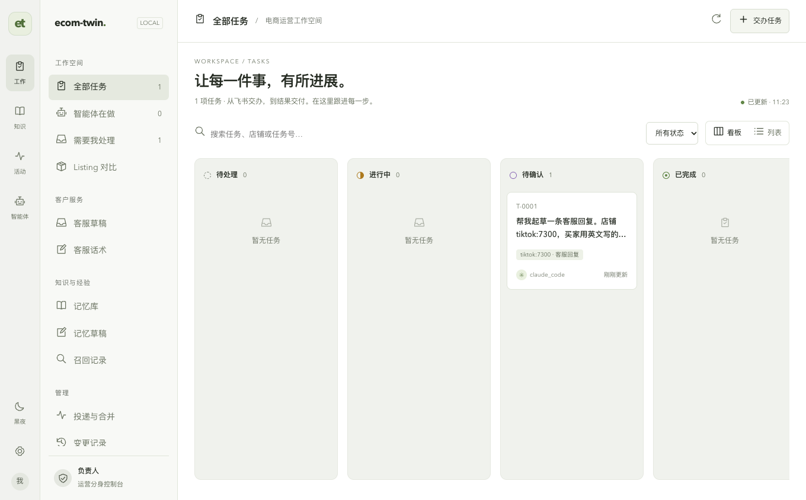

点卡片能看详情：当前步骤、在等什么、交付结果都在这里。

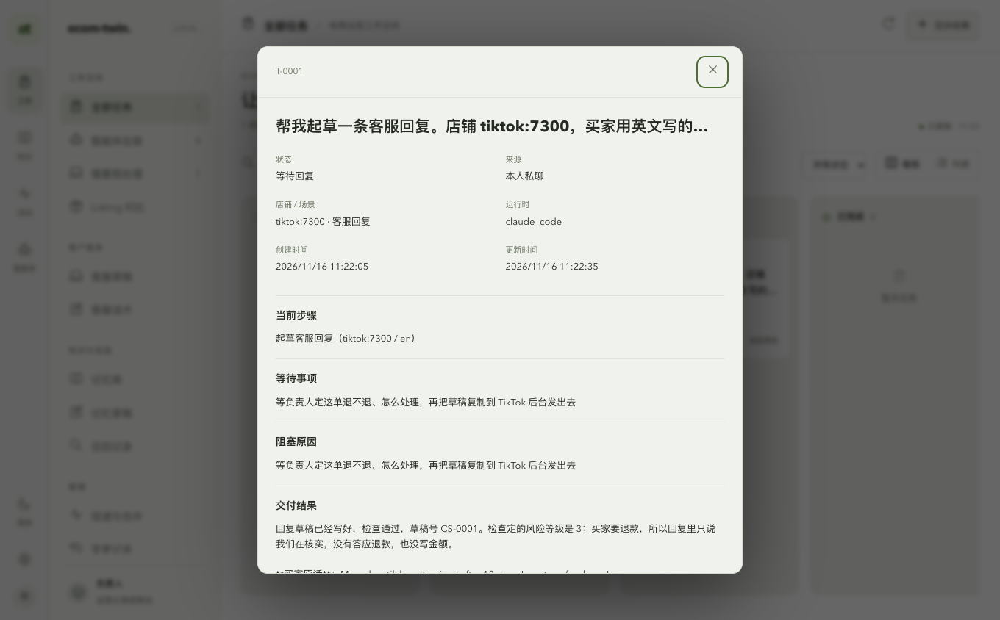

左侧「需要我处理」只列在等你的任务，每天看这一项就够了。

### 4.5 发出去之后，回来标记结果

进「客户服务 → 客服草稿」。每条草稿都附了买家原话、中文意思和风险依据，「复制草稿」可以一键复制：

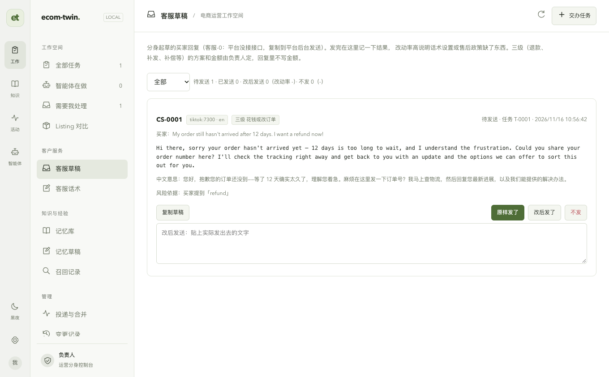

到平台后台发完后，回来点其中一个：

- **原样发了**：一字没改。
- **改后发了**：先把实际发出去的文字贴进下面的框，再点。
- **不发**。

我这次改短了一些再发，标记后页面顶部的改动率变成了 100%：

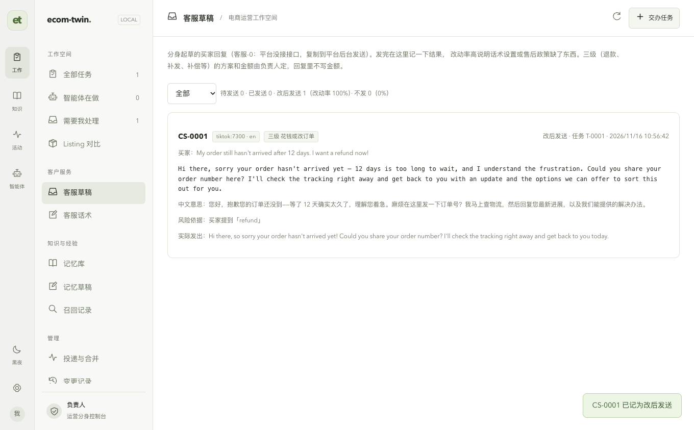

**改动率是用来调话术的。** 如果你总要大改，说明话术样例或售后政策缺了东西，回 4.1 补话术，或者去记忆库补经验。

---

## 5. 记忆库：让它越用越懂你

进「知识与经验 → 记忆库」。这里放你精炼过的运营经验，分身每次开工按要做的事来取。版本里自带了一份「大促日历」：

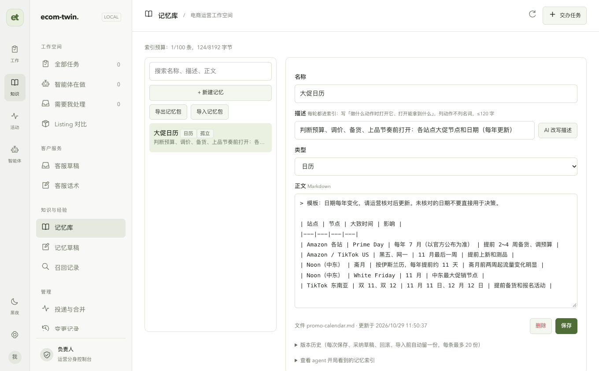

写记忆的规矩：

- **只写经验，不写会过期的事实。** 改价的规矩、大促前怎么备货、某店铺的售后口径，这些该写；某个商品现在的价格不该写，让它现场查。
- **描述决定会不会被找到。** 写成「做什么动作时打开它、打开能拿到什么」，例如「判断预算、调价、备货、上品节奏前打开：各站点大促节点和日期」。写不好可以点「AI 改写描述」。
- 每次保存、采纳草稿、回滚、导入前都会自动留一个历史版本，最多 20 份，改错了能回滚。
- 「导出记忆包 / 导入记忆包」可以把经验分享给同事。

分身干活时发现经验过时或缺失，会在「记忆草稿」里提一份草稿，**你采纳了才进库**，它自己改不了记忆。

### 召回记录：它到底查了什么

「召回记录」记下每次查记忆用了什么关键词、命中了哪条：

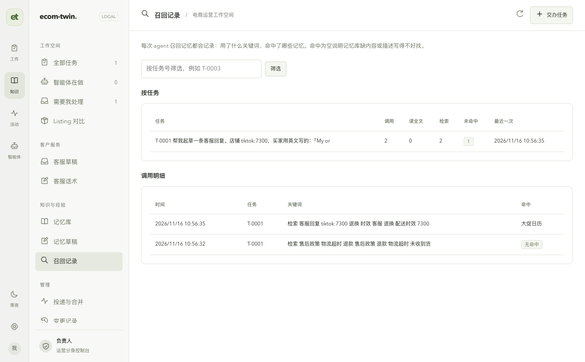

上面那单客服任务查了两次：「售后政策 / 物流超时 / 未收到货」**无命中**，「客服回复 tiktok:7300 退换」只命中了不相关的大促日历。**「无命中」就是在告诉你该补哪条记忆。** 这里应该给 `tiktok:7300` 补一条售后政策，写明未到货超过几天就退。

---

## 6. 管理页面：规则、底座、成本

### 规则配置

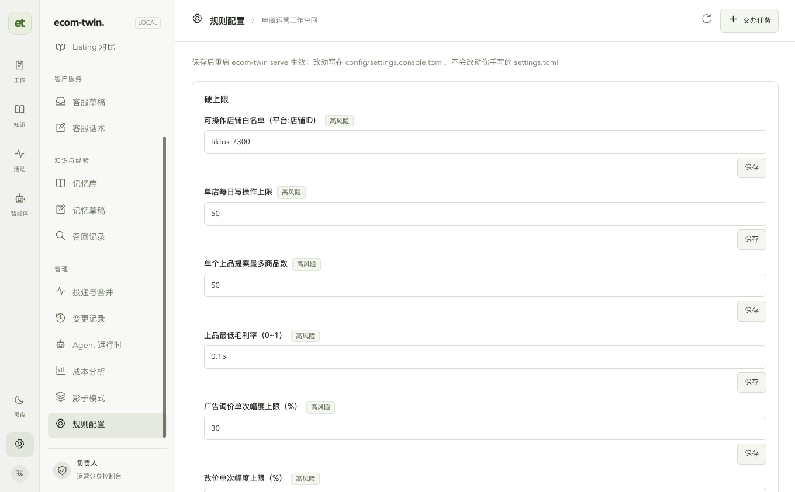

硬上限都在这里：可操作店铺白名单、单店每日写操作上限、单个上品提案最多几个商品、上品最低毛利率、调价单次幅度上限等。这些由执行器代码强制执行，**AI 改不了也绕不过**。

改动写进 `config/settings.console.toml`，不会动你手写的 `settings.toml`。**保存后要重启任务服务（`serve`）才生效。**

### Agent 运行时

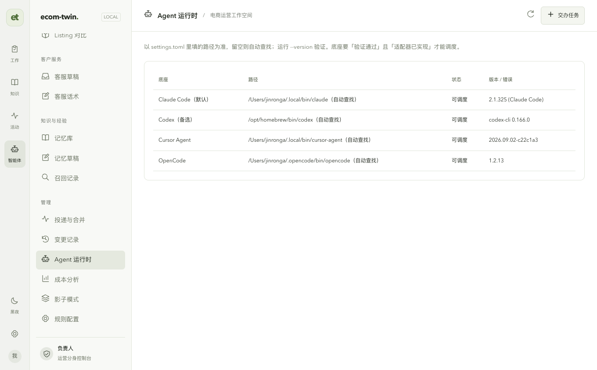

列出本机四种 AI 底座的路径、能不能调度和版本。只有「可调度」的底座才会被派活。默认底座失败时，会自动切到备用底座。

> 打开这页时要逐个跑一遍 `--version`，会先显示「正在检测本机底座」，几秒后出结果。

### 成本分析

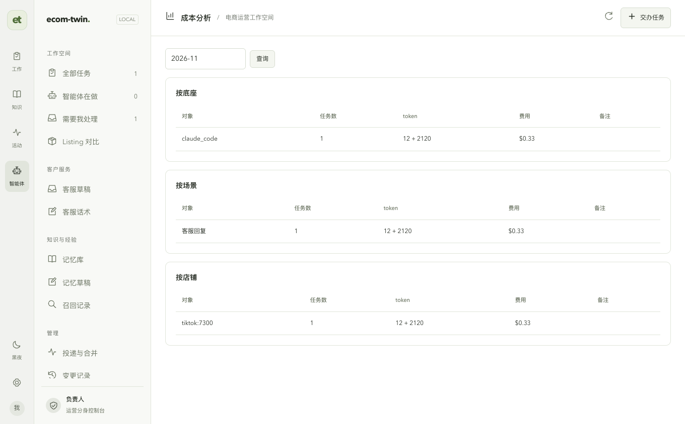

按月份看 token 和费用，按底座、场景、店铺三个维度分开统计。这次体验的那单客服起草花了 $0.33，场景记在「客服回复」、店铺记在「tiktok:7300」下面。

其余几页简单说明：

| 页面 | 用途 |
|---|---|
| Listing 对比 | 暂存区改过的标题、价格，和原文逐字对比 |
| 投递与合并 | 群消息为什么被并进某个任务，或者为什么被忽略（含存疑的判定） |
| 变更记录 | 谁在什么时候改了什么配置 |
| 影子模式 | 新类型操作先只出提案不执行，和人工实际操作比对吻合率，达标再放开 |

---

## 7. 接上飞书之后的日常用法

> 本节暂无截图：这次体验没有接真实飞书。接上之后补「私聊建单回执」「审批卡片」「引用回复续跑」三张截图。

| 想做什么 | 在飞书里怎么做 |
|---|---|
| 交代任务 | 私聊机器人，说清**目标、店铺、完成标准**。文字、图片都行 |
| 接着做同一件事 | **引用**它的汇报消息再回复，会接回原任务，不会新开 |
| 批准提案 | 回复「批准 P-0001」 |
| 拒绝提案 | 回复「拒绝 P-0001 原因编号 备注」。原因编号：1 数据不对 · 2 判断不对 · 3 时机不对 · 4 违反偏好 · 5 其他 |
| 让它在群里盯着 | 在规则配置里加监听群。群里 @分身，或回复了任务里的消息，会自动并进对应任务；闲聊会被忽略 |

拒绝时选的原因会沉淀成经验，下次出提案会参考。提案过期前会提醒你，过期就作废，执行前还会再核一遍数据有没有变。

---

## 8. 常见问题

**控制台保存时提示「feishu.owner_open_id 未填」「limits.allowed_shops 为空」**

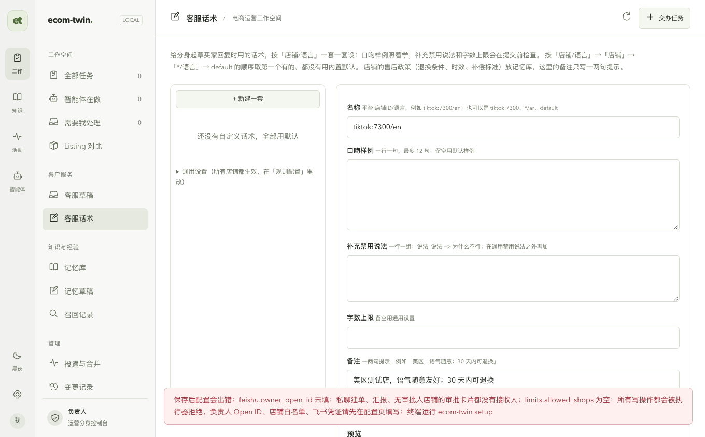

报错里已经写了怎么办：先去配置页（终端运行 `ecom-twin setup`）填负责人 Open ID 和店铺白名单，保存后再回控制台。

**终端提示「妙手不可用」**

没配妙手 AppKey / AppSecret（`.env` 里的 `MIAOSHOU_APP_KEY`、`MIAOSHOU_APP_SECRET`）。妙手相关的能力（上品等）会暂停，客服起草这类不依赖妙手的任务照常能跑。

**私聊了没反应**

依次检查：

1. 任务服务启动了没有（配置页第三步，或 `ecom-twin status`）。
2. 飞书应用是否订阅了 `im.message.receive_v1` 并发布了版本。
3. 你的 open_id 和配置里的负责人 open_id 是否一致（必须同一个应用下的）。

最后跑 `ecom-twin check` 看自检结果。

**想先在不影响正式数据的情况下试试**

用环境变量指定一个单独的数据目录，所有配置、数据库、记忆都会放在那里：

```bash
export ECOM_TWIN_HOME=~/ecom-twin-sandbox
.venv/bin/ecom-twin setup
```

本教程的截图就是这样做出来的。
